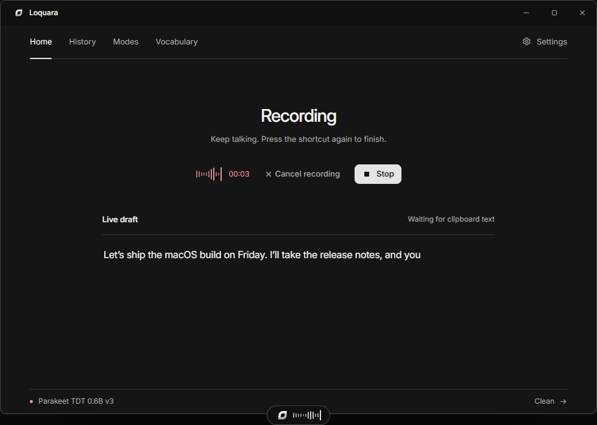

# Loquara

**Private, on-device dictation for Windows, macOS and Linux.**

Press a shortcut anywhere, speak naturally, and the words land at your caret.

[Website](https://loquara.nikodemnowak.pl) · [Releases](https://github.com/NikodemNowak/loquara/releases) · [Issues](https://github.com/NikodemNowak/loquara/issues) · [License](LICENSE)

[](https://github.com/NikodemNowak/loquara/actions/workflows/build.yml)
[](https://github.com/NikodemNowak/loquara/releases)
[](LICENSE)
[](#system-requirements)



*Loquara 0.10.0: one shortcut, a live draft, and a floating recorder. Interface preview; the transcript is sample content.*

## Overview

Loquara is a native desktop dictation app built for people who write all day. It records from the system microphone, transcribes locally with **NVIDIA Parakeet TDT 0.6B v3**, and pastes the result into the focused application.

The default path is entirely local: no account, no cloud API, and no audio leaving the machine. The speech model is downloaded once inside the app, and the same shortcut works in editors, browsers, terminals, chat apps, and anything else that accepts text.

Cloud transcription is optional. If you bring an API key, Loquara can use xAI Grok Voice Transcribe, OpenAI, Groq, Mistral, ElevenLabs, Deepgram, or an OpenAI-compatible endpoint.

## Download

The current release is **v0.10.0** (1 November 2026). See [all releases](https://github.com/NikodemNowak/loquara/releases) for older versions and release notes.

| Platform | File | Size | Notes |
| --- | --- | ---: | --- |
| Windows 10/11, x64 | [Installer `.exe`](https://github.com/NikodemNowak/loquara/releases/download/v0.10.0/Loquara_0.10.0_x64-setup.exe) | 17.6 MB | Per-user install; no administrator rights |
| Windows 10/11, x64 | [MSI package](https://github.com/NikodemNowak/loquara/releases/download/v0.10.0/Loquara_0.10.0_x64_en-US.msi) | 22.3 MB | Alternative MSI installer |
| macOS 11+, Universal | [Disk image `.dmg`](https://github.com/NikodemNowak/loquara/releases/download/v0.10.0/Loquara_0.10.0_universal.dmg) | 44.0 MB | Apple silicon and Intel |
| Linux, X11/XWayland | [Debian package `.deb`](https://github.com/NikodemNowak/loquara/releases/download/v0.10.0/Loquara_0.10.0_amd64.deb) | 22.1 MB | Debian/Ubuntu |
| Linux, X11/XWayland | [AppImage](https://github.com/NikodemNowak/loquara/releases/download/v0.10.0/Loquara_0.10.0_amd64.AppImage) | 93.0 MB | Portable alternative |

The 670 MB Parakeet model is downloaded by the app on first launch.

## Install

### Windows

1. Download and run `Loquara_0.10.0_x64-setup.exe` (or the MSI).
2. Launch Loquara and download the local speech model when prompted.
3. Press `Ctrl+Space` anywhere to start or stop dictation.

The installer is per-user and does not require administrator rights.

### macOS

1. Download `Loquara_0.10.0_universal.dmg`, open it, and drag Loquara to **Applications**.
2. The build is ad-hoc signed, not notarized by Apple. On first launch, **right-click → Open**, or clear the quarantine flag:

   ```bash
   xattr -dr com.apple.quarantine /Applications/Loquara.app
   ```

3. Allow **Microphone** access when prompted.
4. Enable Loquara in **System Settings → Privacy & Security → Accessibility** so it can paste into the focused app. If the keystroke is refused, the transcript remains in the clipboard.
5. Press `Ctrl+Shift+Space` (macOS reserves `Ctrl+Space` for input switching) or your configured shortcut.

### Linux

1. Install the `.deb`, or make the AppImage executable:

   ```bash
   chmod +x Loquara_0.10.0_amd64.AppImage
   ./Loquara_0.10.0_amd64.AppImage
   ```

2. Install `xdotool` for automatic paste:

   ```bash
   sudo apt install xdotool        # Debian / Ubuntu
   sudo dnf install xdotool        # Fedora
   sudo pacman -S xdotool          # Arch
   ```

3. Global shortcuts and automatic paste use **X11**. On Wayland, run Loquara through **XWayland**; a pure Wayland session does not expose global shortcut registration or `xdotool` window access.
4. Download the local model on first launch and press the shortcut to dictate.

## Features

- **System-wide shortcut.** `Ctrl+Space` on Windows and Linux; `Ctrl+Shift+Space` on macOS. Fully configurable, with toggle or push-to-talk mode.
- **Local by default.** NVIDIA Parakeet TDT 0.6B v3 runs through sherpa-onnx. Windows uses DirectML acceleration for NVIDIA, AMD, and Intel GPUs with CPU fallback; macOS and Linux use the publisher's prebuilt CPU engine.
- **Live draft.** Local Parakeet and xAI can build a transcript in the app and clipboard while you speak. The destination stays untouched until you stop, then the complete result is pasted once.
- **Terminal-aware paste.** Uses `Ctrl+V` in standard apps and `Ctrl+Shift+V` in Windows Terminal, WSL, Git Bash, Termius, Alacritty, WezTerm, Ghostty, PuTTY, and Linux terminals when the focused window can be identified.
- **Floating recorder.** A compact, noise-adaptive overlay with clear start, stop, and transcript-ready states.
- **25 languages.** The interface itself is available in Polish and English and follows the system language, with a manual override.
- **Vocabulary and modes.** Teach Loquara names, jargon, and phonetic replacements; transform output with custom rules.
- **History and retention.** Review past recordings and transcripts, and delete audio automatically after 1, 7, or 30 days.
- **Tray integration.** Start dictation, paste the last transcript, or launch minimized to the tray.
- **Optional cloud engines.** xAI, OpenAI, Groq, Mistral, ElevenLabs, Deepgram, and OpenAI-compatible endpoints. Keys are encrypted with Windows DPAPI on Windows; on macOS and Linux they live in the app's SQLite database protected by your user account's file permissions.

## Privacy

Loquara's default configuration does not send audio or transcripts anywhere. The local engine, history, vocabulary, and settings stay on the machine.

Local data lives in:

- **Windows:** `%APPDATA%\io.loquara.desktop\`
- **macOS:** `~/Library/Application Support/io.loquara.desktop/`
- **Linux:** `~/.local/share/io.loquara.desktop/`

Models are stored in the `models/` subdirectory. Cloud transcription is opt-in and requires your own API key; no key is sent anywhere except the selected provider.

## System requirements

| | Minimum |
| --- | --- |
| Windows | Windows 10 or 11, x64; DirectML-capable GPU or CPU |
| macOS | macOS 11 or newer; Apple silicon or Intel (universal build) |
| Linux | X11 or XWayland; Debian/Ubuntu package or AppImage; `xdotool` for automatic paste |
| Memory | 2 GB RAM |
| Disk | 700 MB for the local model |
| Network | Required once to download the model; optional for cloud engines |

## Architecture

Loquara is a Tauri 2 desktop application:

- **Frontend:** React 19, TypeScript, Vite, Fluent UI icons, Radix UI.
- **Desktop shell:** Rust, `cpal` for audio capture, `rusqlite` for local storage. Windows uses Win32 window management and `SendInput`; macOS uses System Events for paste; Linux uses `xdotool` on X11.
- **Speech engine:** native `sherpa-onnx` ONNX Runtime bindings. Windows builds with DirectML; macOS and Linux bundle the upstream prebuilt CPU libraries.
- **Cloud:** optional HTTPS/WebSocket transcription; audio is sent only when a cloud engine is explicitly selected.

## Development

### Prerequisites

- **Node.js 22+** and **pnpm**
- **Rust** stable with edition 2024
- **Windows:** Visual Studio C++ build tools and CMake
- **macOS:** Xcode command line tools
- **Linux:** `libwebkit2gtk-4.1-dev`, `libayatana-appindicator3-dev`, `librsvg2-dev`, `patchelf`, `libasound2-dev`, `libxdo-dev`, `libx11-dev`, `libdbus-1-dev`, `libssl-dev`, and `cmake`

### Run the app

```bash
pnpm install
pnpm tauri dev
```

### Test

```bash
# Frontend
pnpm test

# Rust unit and platform tests
cargo test --manifest-path src-tauri/Cargo.toml --lib
```

On a clean checkout, build the speech engine before the Rust tests so its shared libraries are staged:

```bash
cargo build --manifest-path src-tauri/Cargo.toml -p sherpa-rs-sys
cargo test --manifest-path src-tauri/Cargo.toml --lib
```

### Build installers

```bash
pnpm tauri build
```

Bundles land in `src-tauri/target/release/bundle/`. The GitHub **release** workflow builds Windows, macOS (universal), and Linux on matching runners and uploads the artifacts.

## Release

The release workflow builds and tests the app on Windows, macOS, and Linux, then publishes a draft GitHub release. Publishing a tag such as `v0.10.0` produces the five assets listed under [Download](#download).

Before publishing:

```bash
pnpm test
cargo test --manifest-path src-tauri/Cargo.toml --lib
pnpm build
```

The current CI and release workflows live in [`.github/workflows`](.github/workflows).

## Website

The landing page is a static site in [`site/`](site/), with:

- Polish and English copy selected from the browser language
- Light and dark themes selected from the system
- A live interface preview matching the current app shell
- Direct downloads for every platform and installer format

```bash
pnpm site:dev       # http://localhost:1421
pnpm site:build     # static output in site/dist
pnpm site:preview   # production build at http://127.0.0.1:4173
```

The production URL is [loquara.nikodemnowak.pl](https://loquara.nikodemnowak.pl). Deployment and pre-release checks are documented in [`site/README.md`](site/README.md). The app CI does not publish the site.

## License

MIT — see [LICENSE](LICENSE).
